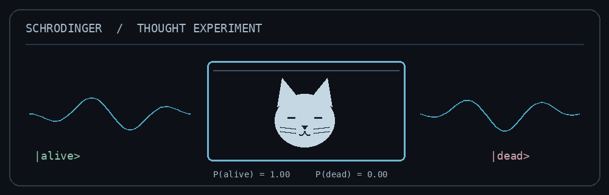

# Amirhoseyn Asghari

**Condensed Matter Theory · Quantum Information · Open Quantum Systems**

*From microscopic correlations to operational quantum resources.*

SUPERPOSITION / MEASUREMENT / INFORMATION

[Research website](https://amirhoseynpowasghari.github.io) &nbsp;·&nbsp; [Research repositories](https://github.com/AmirhoseynpowAsghari?tab=repositories)

---

### Research statement

I am a PhD student in condensed-matter physics studying how microscopic correlations in quantum materials become useful information-theoretic resources—and how those resources evolve in contact with an environment.

My work connects superconducting lattice models, spin–orbit coupling and Bogoliubov–de Gennes (BdG) theory with entanglement, quantum communication and non-Markovian open-system dynamics. I am particularly interested in tracing the full path from a microscopic Hamiltonian to measurable information quantities, without treating the intermediate numerical steps as a black box.

### Research program

| 01 / Microscopic structure | 02 / Quantum resources | 03 / Environmental dynamics |
| :--- | :--- | :--- |
| Superconductivity, lattice Hamiltonians, Rashba spin–orbit coupling, Green's functions and self-consistent BdG theory. | Two-qubit states, entanglement, singlet fraction, teleportation fidelity and Holevo information. | Non-Markovian channels, amplitude damping, dephasing, memory effects and correlated environments. |

**A recurring question:** Which features of a many-body state survive as usable quantum information when realistic decoherence is introduced?

### Current investigations

- Constructing two-qubit states from BdG Green's functions and examining their information-theoretic structure.
- Studying the evolution of singlet fraction and Holevo information under non-Markovian noise.
- Consolidating numerical solvers and observables into a documented, reproducible Python library.

### Computational practice

I develop research code in **Python**, primarily using **NumPy, SciPy, Matplotlib and Jupyter**, with **Git, LaTeX and Linux** supporting the wider workflow. The emphasis is on transparent numerical methods, convergence checks, error analysis and reproducible results.

---

MICROSCOPIC MODELS &nbsp;→&nbsp; QUANTUM CORRELATIONS &nbsp;→&nbsp; OPEN-SYSTEM DYNAMICS &nbsp;→&nbsp; INFORMATION

